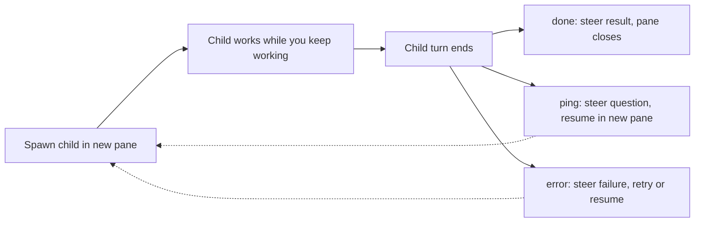

# pi-luvus guide

This guide holds the full reference for pi-luvus. For an overview and install steps, read the [README](../README.md).

## Environment

Luvus is required. Run pi inside a Luvus pane. Outside Luvus the extension spawns nothing. It checks `LUVUS_ENV`, `LUVUS_BIN_PATH`, and `LUVUS_PANE_ID`. Luvus sets these variables for every managed pane.

If shell startup is slow and the prompt drops subagent commands, set `PI_LUVUS_SHELL_READY_DELAY_MS` to a higher value (default `500`):

```bash
export PI_LUVUS_SHELL_READY_DELAY_MS=2500
```

Child panes open without stealing keyboard focus (`pane split --no-focus`). Launch commands target child panes by explicit ID. Focus and command delivery stay independent. The `interactive` option controls parent notifications. It does not control terminal focus.

## Pane titles

Each child pane carries an OSC 2 title of `<name> — <task>`. `<task>` is the first non-empty line of the task, truncated to 48 characters. With no task text, the title shows only the name. The Luvus AGENTS sidebar shows this live title on the second line of the row. Parallel child panes stay easy to tell apart. The title is additive: `luvus pane name` still sets the pane alias, and `=name` references keep working.

An unnamed pi pane that is not a subagent also gets a title from its first prompt. The extension sets the OSC title to `π - <prompt> - <cwd basename>`. `<prompt>` is the first non-empty line of the first user prompt, cut to 48 characters. Before the first prompt, pi's own title stays. The extension sets the title again on reload.

A pi session with a name keeps pi's own title `π - <name> - <cwd>`. The extension does not set a title for it. A subagent pane keeps `<name> — <task>`.

`luvus agent list` shows the row title as `agent_session_title`.

---

## Resume pi sessions

Luvus binds the id of every pi session to its pane (see [Live pi status in Luvus](#live-pi-status-in-luvus)). When the pane closes, the session file stays on disk, and the session becomes a resumable session.

List the resumable sessions:

```bash
luvus agent sessions
```

The command reads the session files live and prints JSON. Each entry in `result.sessions[]` holds `agent` (`pi` for a pi session), `cwd`, and `session_id`.

Reopen a session in a new pane:

```bash
luvus agent resume <session id>
```

The command prints only `{"type":"ok"}`. It does not print the new pane id. Find the new pane with:

```bash
luvus pane list --all-tabs
```

To find the pane that holds a session, run `luvus agent get <pane>` and read its `session` field.

A session reopened this way starts without the role configuration of a `luvus_spawn` child. To resume a child and keep its role, use `luvus_resume` with the child session file (see [Resuming a subagent](#resuming-a-subagent)).

The AGENTS history row shows only the project folder.

---

## Live pi status in Luvus

The extension reports the live state of every pi pane to Luvus, including panes that never spawn a subagent. Without it, Luvus shows each pi pane as `idle`, even during a turn. The report is a Luvus integration lease. A lease is a temporary status claim.

The extension reports `working` while a turn runs and `idle` while the session waits for input. A `working` report carries the name of the running tool as its message. Read the message with `luvus agent explain <pane>` as `authority.message`; `luvus agent list` has no message field. While the `bash` tool runs, for example, the status is `working` with message `bash`. When the tool ends and the turn continues, the status is `working` with no message.

The lease has a 300-second TTL. The extension renews the lease at half the TTL, also while pi is idle, so an idle pane keeps its status. Renewal stops after a terminal `done` or `blocked` report, or on shutdown. On shutdown with no terminal status, the extension releases the lease.

`working` and `idle` reports, and renewals, run in the background. They do not block the pi event loop, and a failed or slow report does not delay a turn. A later transition reports again. Terminal reports (`done`, `blocked`) and the release stay synchronous. A subagent publishes a terminal report at its exit, and that report must land before the sidecar write and the shutdown.

The extension also binds the pi session id to the pane at session start.

---

## Turn-end notification

When a turn ends in a parent pi pane that does not have focus, the extension pushes one Luvus notification, so you do not have to visit every pane to learn that it waits for input. A normal turn sends `pi turn ended: <label>` at level `success`. A turn whose last assistant message failed sends `pi turn failed: <label>` at level `error`. An aborted turn sends nothing. The label is the session name, or the basename of the session cwd when the session has no name.

Subagent children send no notification: their completion already reaches the parent through the status lease and `luvus_done`. Outside Luvus the extension makes no notification call. The focus check and the push run in the background, and a failed or slow Luvus call results in no notification and never delays the next turn.

Set `notify.enabled` to `false` in `config.json` to turn these notifications off (see [Configuration](#configuration)). Do that if Luvus already cues your pi panes for status changes.

---

## External orchestrators (Claude Code)

Install the `pi-luvus` skill first (see the [README](../README.md#external-orchestrators-claude-code)).

The skill launcher `launch.ts` prepares everything outside the child pane. It finds the child extension, resolves the role, appends the parent-contact footer to the brief, splits and names a new pane, and writes the launch spec. A launch spec is a JSON file that starts one child. Run it with `node`:

```bash
node <skill-dir>/launch.ts start --name <child> --role <role> --cwd <dir> --brief <file> --parent <me> [--scratch <dir>] [--close-grace-ms <n>] [--surface right|down|tab]
```

On success it prints JSON with the pane id, the session file, and the launch-spec path. A follow-up always runs in a new pane from the same launch spec:

```bash
node <skill-dir>/launch.ts resume --launch <path> --prompt <file> [--name <child>] [--surface right|down|tab]
```

The `--surface` flag places the new pane. `right` (default) splits the caller pane side by side. `down` stacks the new pane below it. `tab` opens its own workspace tab. If the flag is absent, the value comes from the `surface` key in the extension `config.json` (`"pane"` is accepted as an alias for `"right"`). On a `done` sidecar the child pane closes itself, split or tab.

For the report cross-check, run `node <skill-dir>/launch.ts last-message --session <file>`. It prints the last assistant message of the session, or `(no assistant message)`.

Completion signal: a child that finishes, pings, or errors publishes a terminal Luvus status before it exits. It reports through its `pi-luvus-status` lease. A lease is a temporary status claim. It reports `done`, or `blocked` with the ping question or error text as the message. Wait for the status. Do not poll the pane:

```bash
luvus wait agent-status <pane> --status done,blocked --timeout <seconds>
```

`wait` exits 0 when the status matches, and 2 on timeout or a missing pane. The terminal status survives the pi process for up to 300s (the lease TTL) while the pane stays open. This behavior is verified on luvus 0.14.3. `agent list` still lists the pane with `authority` / `state_source` `integration_report` and status `done` / `blocked`. `agent explain` shows `authority.source "pi-luvus-status"`. `wait --status done,blocked` returns in ~0.1s.

The wait is sound only while the pane holds an authoritative integration lease (`authority` / `state_source` `integration_report`). On a pane with no live agent (an expired lease or a plain shell), the Luvus `command_fallback` can read `done` and the wait returns at once. Never treat an immediate return alone as completion. Check `luvus agent list` or `agent explain` for the authority of the pane first. The `.exit` sidecar stays the authoritative lifecycle record. The status is only a wake-up signal.

Close-on-done: after pi exits, the run wrapper closes its own pane only when the session `.exit` sidecar holds `{"type":"done"}`. It first waits a grace period of 5000 ms by default. Set it per launch with `start --close-grace-ms <n>`. `0` closes at once. The delay lets a blocked `luvus wait` in the orchestrator observe the terminal lease before the pane goes away. A provider error, a `caller_ping`, or a crash leaves the pane open with the `__SUBAGENT_DONE_<n>__` sentinel visible, so you can inspect the failure. Close those panes yourself when done with them.

---

## Async Subagent Flow

```
1. Agent calls luvus_spawn()          → returns immediately ("started")
2. Sub-agent runs in a Luvus pane  → widget shows live status
3. User keeps chatting             → main session fully interactive
4. Sub-agent finishes              → result steered back as a normal completion/failure
5. Main agent processes result     → continues with new context
```

Subagents run concurrently. Each result arrives independently when its child finishes.

```
╭─ Subagents ───────────────────────────────── 3 running ─╮
│ 01:23  Scout: Auth (scout)            active · write 7m │
│ 00:45  Researcher (researcher)               stalled 4m │
│ 00:12  Scout: DB (scout)                      starting… │
╰─────────────────────────────────────────────────────────╯
```

Completion messages render with a colored background and are expandable with `Ctrl+O` to show the full summary and session file path. The message names `luvus_resume` with the session file to continue the child.

### Decision model

Each child run has one of three outcomes: `done`, `ping`, or `error`. The `.exit` sidecar records the outcome. The orchestrator delivers it as a steer message.



The sections below hold the details. Child exit rules live under `auto-exit` and the completion nudge. Parent backstop rules live under the idle watchdog. External orchestrator rules live in `skills/pi-luvus/SKILL.md`. The normative spec is `openspec/specs/luvus-completion/spec.md`.

### In-progress status updates

The widget tracks each Pi-backed sub-agent from a child-written runtime snapshot and labels it with a coarse state:

- `starting` — launched, but no valid child snapshot has been observed yet
- `active` — the child is doing observed runtime work: agent turn, provider request, streaming, or tool execution
- `waiting` — the child finished a turn and is intentionally open for more input or another stage
- `stalled` — the parent has gone too long without a valid current child snapshot and can no longer trust the run is healthy
- `running` — fallback for backends without child snapshots (e.g. Claude)

Session-file growth does not drive these labels. Session JSONL still stores the transcript and still supports resume, lineage, and result extraction. Pi-backed liveness comes from a small activity snapshot. The child extension writes the snapshot. A fixed internal watchdog marks a run as `stalled` when valid snapshots never appear, stop being readable, or stop matching the current child. A long-running `active` or `waiting` state never becomes `stalled` from time alone. When a run enters `stalled` or recovers from it, the parent receives a steer message. All other transitions stay in the widget only.

Interactive subagents stay silent. A long-running user-driven child (for example a forked session with full conversation context) does not wake the parent on `stalled` or `recovered` transitions. The user works directly in the child pane. A steer message there burns an orchestrator turn on a no-op ping. The widget still updates normally. Snapshots are still recorded and classified under any `interactive` value. By default, agents with `auto-exit: true` are autonomous and get stall pings. Agents without it are interactive and stay quiet. Override per agent with `interactive: true|false` in frontmatter. Override per spawn with `interactive: true|false` on the tool call.

#### Configuration

The extension configuration controls the status display. It lives at `~/.pi/agent/extensions/pi-luvus/config.json`. It lives under `$PI_CODING_AGENT_DIR` when that variable is set. This location survives `pi update`. Seed the file from the shipped example:

```bash
mkdir -p ~/.pi/agent/extensions/pi-luvus
cp config.json.example ~/.pi/agent/extensions/pi-luvus/config.json
```

If an older install left a `config.json` at the package root, reads still honor it. The first `/luvus-surface` save migrates it to the new location.

```json
{
  "status": {
    "enabled": true
  },
  "notify": {
    "enabled": true
  },
  "module": {
    "autolink": true
  },
  "surface": "right"
}
```

Git ignores `config.json`. Local overrides stay uncommitted.

`"module.autolink"` controls the module link on start. It defaults to `true`. Set it to `false` to link the module yourself.

`"notify.enabled"` controls the turn-end notification (see [Turn-end notification](#turn-end-notification)). It defaults to `true`. Set it to `false` if Luvus already cues your pi panes for status changes.

`"surface"` controls where children open. `"right"` (default) splits your pane side by side. `"down"` stacks the child below. `"tab"` gives it its own workspace tab. The older value `"pane"` is still accepted and means `"right"`. Change it live with `/luvus-surface right|down|tab`. Override one spawn with the `surface` parameter on the `luvus_spawn` tool.

---

## Spawning Subagents

```typescript
// Named agent with defaults from agent definition
luvus_spawn({ name: "Scout", agent: "scout", task: "Analyze the codebase..." });

// Force a full-context fork for this spawn
luvus_spawn({ name: "Fork", fork: true, task: "Fix the bug where..." });

// Custom working directory
luvus_spawn({ name: "Designer", agent: "game-designer", cwd: "agents/game-designer", task: "..." });
```

### Parameters

| Parameter      | Type    | Default                 | Description                                                                                                                                                                                                                                                                                        |
| -------------- | ------- | ----------------------- | -------------------------------------------------------------------------------------------------------------------------------------------------------------------------------------------------------------------------------------------------------------------------------------------------- |
| `name`         | string  | required                | The display name. It appears in the widget and the pane title.                                                                                                                                                                                                                                     |
| `task`         | string  | required                | The task prompt for the child.                                                                                                                                                                                                                                                                     |
| `agent`        | string  | —                       | It loads defaults from the agent definition.                                                                                                                                                                                                                                                       |
| `fork`         | boolean | `false`                 | It forces the full-context fork mode for this spawn. It overrides any agent `session-mode` frontmatter.                                                                                                                                                                                            |
| `interactive`  | boolean | derived                 | It marks this spawn as interactive (it does not wake the parent on stall or recovery). It defaults to the `interactive` frontmatter of the agent, otherwise to the inverse of `auto-exit`.                                                                                                         |
| `model`        | string  | —                       | It overrides the default model of the agent.                                                                                                                                                                                                                                                       |
| `systemPrompt` | string  | —                       | It appends to the system prompt.                                                                                                                                                                                                                                                                   |
| `skills`       | string  | —                       | A comma-separated list of skill names.                                                                                                                                                                                                                                                             |
| `tools`        | string  | —                       | A comma-separated list of tool names.                                                                                                                                                                                                                                                              |
| `cwd`          | string  | —                       | The working directory for the child (see [Role Folders](#role-folders)).                                                                                                                                                                                                                           |
| `surface`      | string  | extension configuration | It places this spawn. `"right"` (default) splits the caller pane side by side. `"down"` stacks it below. `"tab"` opens the child in its own workspace tab. `"pane"` is an alias for `"right"`. It overrides the `surface` key in `config.json` for this spawn. |

---

## Interrupting a running subagent

Use `luvus_interrupt` to cancel the active turn of a running Pi-backed subagent:

```typescript
luvus_interrupt({ id: "abcd1234" });
// or
luvus_interrupt({ name: "Scout" });
```

This sends Escape to the child pane and cancels the active model turn. The session stays alive. The pane, the session file, and the background polling all stay intact. After the interrupt, the widget moves the child back to `waiting` at once and ignores stale pre-interrupt snapshots. If the child starts work later, newer snapshots return it to `active`. Completion, failure, and `caller_ping` still flow normally. This is a turn-level interrupt. It does not terminate a session.

> **Note:** It supports only Pi-backed children. A Claude-backed run returns an error.

---

## Resuming a subagent

`luvus_resume` starts a finished child in a new pane from its session file. It resumes pi children and Claude Code children. For a child that `luvus_spawn` started, the resume restores the role configuration from the spawn: the agent, the working directory, the model, the tool allowlist, the role prompt, the denied tools and the auto-exit value. The pane keeps the display name from the spawn.

`luvus_spawn` writes a launch record beside the child session file, `<session>.launch.json`. The record holds the values that the spawn resolved. A resume reads that record and does not read the agent file again. The resumed child therefore keeps the role configuration from spawn time even if the agent file changes later.

A Claude Code child has no pi session file. Its launch record stores the Claude Code session id when the run ends, and its result carries the child session path. `luvus_resume` starts Claude Code with `--resume <session id>` and `message` as the prompt. When the record has no stored session id, the tool returns an error and starts nothing.

A session with no launch record, for example one that the skill launched, resumes as a plain pi session named `Resume`. Its tool result says that the role configuration was not restored. When the session file is missing as well, the tool returns an error and starts no pane.

### Parameters

| Parameter     | Type    | Description                                                                                                                                                                                                                                                                                       |
| ------------- | ------- | ------------------------------------------------------------------------------------------------------------------------------------------------------------------------------------------------------------------------------------------------------------------------------------------------- |
| `sessionPath` | string  | Required. The child session file. For a Claude Code child, use the session path from its result.                                                                                                                                                                                                  |
| `message`     | string  | The follow-up prompt. With no message, the child resumes without a prompt.                                                                                                                                                                                                                        |
| `surface`     | string  | `"right"` (default) splits the caller pane side by side. `"down"` stacks it below. `"tab"` opens the resumed session in its own workspace tab. It overrides the `surface` key in `config.json` for this resume.                                                                                      |
| `autoExit`    | boolean | Whether the resumed session auto-exits after its next response. When absent, the launch record's auto-exit and interactive values apply. `false` runs the resumed child interactively, so stall and recovery transitions do not wake the parent.                                                    |

The `name` parameter is removed: the resumed pane uses the name from the launch record, or `Resume` when there is no record. `luvus_spawn` also no longer takes `resumeSessionId`; use `luvus_resume` with the session file.

---

## Messaging other agents

Use `luvus_message` to pass text to another agent in the same tree. Everyone keeps working:

```typescript
luvus_message({ to: "parent", message: "Which DB driver should I use?" });
luvus_message({ to: "Reviewer", message: "API is in src/api.ts" });
```

Reachable targets: exactly these three, nothing else:

- `parent` — the agent that spawned you (subagents only)
- the display name or id of one of your own running children
- the display name or id of a running sibling (another running child of your parent)

Grandchildren, grandparents, finished children, and unrelated agents are not reachable. If you message a finished child, the tool returns an error that lists the reachable targets. Use `luvus_resume` for a finished session. If a name is ambiguous, pass the exact subagent id.

Delivery uses two paths. Messages to children and siblings go through Luvus `agent prompt`. They appear in the target pane as input with a sender header (for example `[subagent message from Worker (sibling)]`). Messages to `parent` append to the child message file. The parent injects them as a steering message. They never touch a draft that the user types in the parent composer.

Delivery is asynchronous. The tool returns when the message is queued. Any reply arrives later as a separate message. The tool reports a Luvus error such as `agent_not_ready`. It never retries automatically.

These tools differ. `caller_ping` and `luvus_done` end the sending session. `luvus_message` does not end it.

> **Note:** Claude Code children can receive messages. They have no `luvus_message` sending tool.

---

## caller_ping: child-to-parent help request

The `caller_ping` tool lets a child request help from its parent. When the child calls it, the child session exits and the parent receives a notification with the help message. The parent then resumes the child session with a response through `luvus_resume`.

`caller_ping` takes one parameter: `message` (required) holds the help text.

`luvus_resume` takes the child `sessionPath` (required) and an optional `message`. It restores the role configuration from the launch record. Read [Resuming a subagent](#resuming-a-subagent) for all parameters.

Interaction flow:
1. The child calls `caller_ping({ message: "Not sure which schema to use" })`.
2. The child session exits (like `luvus_done`).
3. The parent receives a steer notification: *"Sub-agent Worker needs help: Not sure which schema to use"*.
4. The parent resumes the child session through `luvus_resume` with the response.
5. The child picks up where it left off with the guidance of the parent.

Example:
```typescript
// Inside a worker subagent
await caller_ping({
  message: "Found two conflicting migration files — should I use v1 or v2?"
});
// Session exits here. Parent receives the ping, then resumes this session
// with guidance like "Use v2, v1 is deprecated"
```

> **Note:** Call `caller_ping` only inside a child. A standalone pi session returns an error.

---

## Custom Agents

To add a custom agent, place a `.md` file in `.pi/agents/` (project) or `~/.pi/agent/agents/` (global):

```markdown
---
name: my-agent
description: Does something specific
model: openrouter/z-ai/glm-5.3-flash
thinking: minimal
tools: read, bash, edit, write
session-mode: lineage-only
spawning: false
---

# My Agent

You are a specialized agent that does X...
```

### Frontmatter Reference

| Field                      | Type    | Description                                                                                                                                                                                                                                                                                                                                |
| -------------------------- | ------- | ------------------------------------------------------------------------------------------------------------------------------------------------------------------------------------------------------------------------------------------------------------------------------------------------------------------------------------------ |
| `name`                     | string  | The agent name. Use it in `agent: "my-agent"`.                                                                                                                                                                                                                                                                                             |
| `description`              | string  | It appears in `luvus_list` output.                                                                                                                                                                                                                                                                                                     |
| `model`                    | string  | The default model (for example `openrouter/z-ai/glm-5.3-flash`).                                                                                                                                                                                                                                                                             |
| `thinking`                 | string  | Thinking level: `minimal`, `medium`, `high`.                                                                                                                                                                                                                                                                                               |
| `tools`                    | string  | Native pi tools only, as a comma-separated list: `read`, `bash`, `edit`, `write`, `grep`, `find`, `ls`.                                                                                                                                                                                                                                    |
| `skills`                   | string  | A comma-separated list of skill names to auto-load.                                                                                                                                                                                                                                                                                        |
| `session-mode`             | string  | The default child-session mode: `standalone`, `lineage-only`, or `fork`.                                                                                                                                                                                                                                                                   |
| `spawning`                 | boolean | Set `false` to deny all child-spawning tools.                                                                                                                                                                                                                                                                                              |
| `deny-tools`               | string  | A comma-separated list of extension tool names to deny.                                                                                                                                                                                                                                                                                    |
| `auto-exit`                | boolean | Auto-shutdown when the agent finishes its turn, with no `luvus_done` call. If the user sends any input, auto-exit is disabled permanently and the user takes over the session. Use it for autonomous agents (scout, worker). Do not use it for interactive ones. It also sets the default value of `interactive` (see below). |
| `interactive`              | boolean | Default: derived. It overrides whether stall and recovery transitions wake the parent session. It defaults to the inverse of `auto-exit`. Autonomous agents (`auto-exit: true`) are non-interactive and get stall pings. Agents without `auto-exit` are interactive and stay quiet. Explicit values take precedence.                       |
| `cwd`                      | string  | The default working directory (absolute or relative to project root).                                                                                                                                                                                                                                                                      |
| `disable-model-invocation` | boolean | It hides this agent from discovery surfaces like `luvus_list`. The agent stays directly invocable by explicit name through `luvus_spawn({ agent: "name", ... })`.                                                                                                                                                                         |

---

Discovery still resolves precedence before visibility filtering. If a project-local hidden agent has the same name as a visible global or bundled agent, the hidden project agent wins. The lower-precedence agent does not appear in `luvus_list`.

### `session-mode`

Choose how a child session starts:

- `standalone`: Default. A fresh session with no lineage link to the caller.
- `lineage-only`: A fresh blank child session with `parentSession` linkage and no copied turns from the caller.
- `fork`: A linked child session seeded with the prior conversation context of the caller.

`lineage-only` fits when session discovery and fork lineage UX must show the relationship later, but the child must not inherit the turns of the parent.

`fork: true` on the tool call always forces `fork` mode for that spawn.

```yaml
---
name: my-agent
session-mode: lineage-only
---
```

### `auto-exit` and the completion nudge

Agents with `auto-exit: true` exit themselves. When the agent finishes a turn normally and the user has not taken over the pane, the child writes the `done` `.exit` sidecar and the session ends, with no `luvus_done` call. The last assistant message becomes the result for the parent. An aborted turn (Escape) keeps the session open for inspection or another prompt. Error stops still exit at once with the error sidecar reported to the parent.

If the user types into an auto-exit agent pane after its first run, the session becomes user-owned. Auto-exit is disabled from that point. The nudge below takes over.

All other sessions exit through an explicit tool call: `luvus_done` to finish, or `caller_ping` to hand a question back to the parent. To make that reliable, the child extension nudges itself. When the agent finishes a turn normally without calling `luvus_done`, it receives a follow-up reminder after 5 seconds:

> [Automated reminder] Your last turn ended but this session is still open.
> If your task is complete, call the luvus_done tool now, with no other text. Your last message was already delivered as your report — do not repeat or summarise it.
> If you are blocked and need input from the caller, call caller_ping with your question.
> Otherwise, continue working.

These events cancel a pending nudge: the agent starts new work, the user types into the pane, or the agent calls `luvus_done` or `caller_ping`. Error stops never nudge. They still exit at once and report the failure to the parent.

Configure the nudge with environment variables (read by the child at launch):

| Variable                     | Default | Purpose                                  |
| ---------------------------- | ------- | ---------------------------------------- |
| `PI_LUVUS_NUDGE_DELAY_MS` | `5000`  | Delay before the reminder (minimum 1000) |
| `PI_LUVUS_NUDGE_DISABLE`  | unset   | Set to `1` to disable the nudge entirely |

Parent-side idle watchdog. The child nudge depends on the child and the model, so the parent backs it up. For non-interactive children, if the child activity file has said `waiting` (turn ended) for 30 seconds without the session exiting, the parent types a reminder into the pane itself. After two such reminders, if the child still waits another 30 seconds, the parent finishes it as if `luvus_done` had been called. The last assistant message becomes the result, and the pane closes. The parent never touches interactive children. The timings live in `pi-extension/luvus/idle-watchdog.ts`.

What `auto-exit: true` does: it ends the session when the turn of the agent completes normally (see above), and it shapes defaults:

- The task hint tells the agent upfront to call `luvus_done` when finished ("Complete your task autonomously. Call luvus_done when finished.").
- It sets the default for `interactive` (see below). `auto-exit: true` agents count as autonomous and get stall pings. Agents without it count as interactive and stay quiet.

```yaml
---
name: scout
auto-exit: true
---
```

### `interactive`

It controls whether status transitions (`stalled`, `recovered`) wake the parent session with a steer message.

Default: the inverse of `auto-exit`. Autonomous agents (`auto-exit: true`) are non-interactive and ping the parent on stall and recovery. Agents without `auto-exit` are interactive and stay quiet. Bare spawns with no agent definitions (for example a bare spawn with `fork: true`) count as interactive.

Why it exists: interactive agents can run for minutes or hours while the user thinks, types, and reads in the child pane. Child snapshots still update the widget. Stalled and recovered supervision messages rarely need to wake the parent for user-driven sessions. Skipped steers keep the parent quiet until the child actually finishes.

When to override:

- Set `interactive: false` on an agent without auto-exit when you still want stall pings.
- Set `interactive: true` on an autonomous agent when you prefer to check on it yourself.

```yaml
---
name: my-agent
# interactive defaults to true because auto-exit is not set
---
```

Or per spawn:

```typescript
luvus_spawn({ name: "Scout", agent: "scout", interactive: true, task: "..." });
```

---

## Tool Access Control

By default, every child can spawn further children. Control this behavior with frontmatter:

### `spawning: false`

It denies all child lifecycle tools (`luvus_spawn`, `luvus_interrupt`, `luvus_list`, `luvus_resume`):

```yaml
---
name: worker
spawning: false
---
```

### `deny-tools`

For control over individual extension tools:

```yaml
---
name: focused-agent
deny-tools: subagent
---
```

### Recommended Configuration

| Agent      | `spawning`  | Rationale                            |
| ---------- | ----------- | ------------------------------------ |
| worker     | `false`     | Implements tasks, does not delegate. |
| researcher | `false`     | Researches, does not spawn.          |
| reviewer   | `false`     | Reviews, does not spawn.             |
| scout      | `false`     | Gathers context, does not spawn.     |

---

## Role Folders

The `cwd` parameter starts a child in a specific directory with its own configuration:

```text
project/
├── agents/
│   ├── game-designer/
│   │   └── CLAUDE.md          ← "You are a game designer..."
│   ├── sre/
│   │   ├── CLAUDE.md          ← "You are an SRE specialist..."
│   │   └── .pi/skills/        ← SRE-specific skills
│   └── narrative/
│       └── CLAUDE.md          ← "You are a narrative designer..."
```

```typescript
luvus_spawn({ name: "Game Designer", cwd: "agents/game-designer", task: "Design the combat system" });
luvus_spawn({ name: "SRE", cwd: "agents/sre", task: "Review deployment pipeline" });
```

To set a default `cwd`, put it in the agent frontmatter:

```yaml
---
name: game-designer
cwd: ./agents/game-designer
spawning: false
---
```

---

## Tools Widget

Every child session shows a compact tools widget with available and denied tools. Toggle it with `Ctrl+H`:

```text
[scout] — 12 tools · 4 denied  (Ctrl+H)              ← collapsed
[scout] — 12 available  (Ctrl+H to collapse)          ← expanded
  read, bash, edit, write, todo, ...
  denied: subagent, luvus_list, ...
```

---

## Runtime notes

No Unix shell is needed at runtime. Every child spawns with argument arrays. The pane command line is a single `node` command. The package ships no shell scripts. On Windows the launch path works without Git-Bash, WSL, or another Unix layer.
